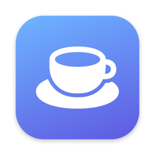

# Caffeinate

A small macOS menu bar app that keeps your Mac awake, with a timer and global shortcuts.

<p align="center">
  
</p>

## Features

- Keep awake for 15 min, 30 min, 1 h, 2 h, 4 h, 8 h, indefinitely, or a custom time.
- Pick what stays awake: the screen, just the Mac (screen may turn off), or the Mac with the lid closed while plugged in.
- Auto-start whenever an external monitor is connected.
- ⌥⌘K toggles it from any app. Shortcuts are rebindable in Settings.
- Launch at Login. No Dock icon.

## Requirements

- macOS 14 or later.
- Xcode 16 or later, with its command line tools selected:
  ```sh
  sudo xcode-select -s /Applications/Xcode.app
  ```

No Apple Developer account is needed.

## Build and install

```sh
git clone <this repo>
cd caffeinate
scripts/build-app.sh
cp -R build/Caffeinate.app /Applications/
open /Applications/Caffeinate.app
```

A cup icon appears in the menu bar. Click it for the panel, right-click for Settings and Quit.

The first build downloads one dependency and takes about a minute. After that, rebuilds take a few seconds.

## Share it with another Mac

```sh
ditto -c -k --keepParent build/Caffeinate.app Caffeinate.zip
```

On the other Mac, unzip it into `/Applications`. Because the app is not notarized, the first launch will be blocked. Either right-click the app and choose Open, or run:

```sh
xattr -dr com.apple.quarantine /Applications/Caffeinate.app
```

## Development

```sh
swift build    # debug build
swift test     # run tests
```

Open `Package.swift` in Xcode if you prefer an IDE.

## Troubleshooting

- **Shortcut does nothing**: another app owns that key combination. Change it in Settings → Shortcuts.
- **Launch at Login fails**: run the app from `/Applications`, not from the `build/` folder.
- **Need a clean build**: `rm -rf .build build && scripts/build-app.sh`
